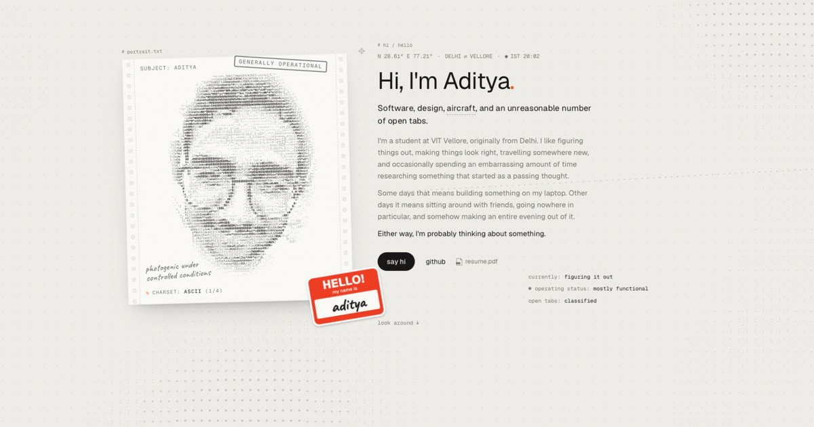

# adityamadan.cv

My corner of the internet: **[adityamadan.cv](https://adityamadan.cv)**

It isn't a résumé. It's a light paper board covered in things from my life: an ASCII printout of my face, a polaroid from Japan, pinned notes, flight strips, a logbook, a departure board and a boarding pass. Scrolling flies a camera from one cluster to the next, like a plane following a route.



## Things to try

- **Scroll** to fly between zones. Drag empty board to pan. Press **Z** to zoom out to the whole board and click a frame to fly there.
- **The terminal at the bottom is the navigation.** Type `help`, `ls`, `cd hangar`, `open japan`, `whoami`, `music` or `theme`. `/` or `⌘K` focuses it, Tab completes, ↑↓ walks history.
- **Drag** any object by its frame name, or peel the name sticker.
- **Click** the portrait to change its character set. **Hold** it to see the real photo.
- **Fill in the boarding pass** and drag it to the gate to send me a message.
- Music is a lo-fi loop synthesized live in the browser. It starts with your first click; `music off` mutes it.
- A few small things react when you hover them. The smaller they are, the likelier.

## Stack

| | |
|---|---|
| Framework | [Vite](https://vite.dev) + [React 19](https://react.dev) + TypeScript |
| Styling | [Tailwind CSS v4](https://tailwindcss.com) with design tokens in `src/index.css` (light "day" and dark "night" themes) |
| Motion | [Motion](https://motion.dev), [GSAP](https://gsap.com) (SplitText and ScrambleText for the scrambling headline), and a custom camera for the board |
| Components | A handful from [React Bits](https://reactbits.dev): SplitFlapText, FlipCard, Magnet, DecryptedText, VariableProximity, ScrambledText, ClickSpark |
| Audio | WebAudio only. Every note, drum and UI click is synthesized; no audio files |
| Contact | [Web3Forms](https://web3forms.com), with a pre-filled `mailto:` fallback |
| Fonts | Geist, Geist Mono and Caveat, self-hosted as woff2 |

## Getting started

Needs Node 20 or newer.

```sh
npm install
cp .env.example .env    # add your Web3Forms key so the contact form can send
npm run dev             # http://localhost:5173
```

```sh
npm run build           # type-checks, then builds to dist/
npm run preview         # serves the production build
```

### Environment

| Variable | What it's for |
|---|---|
| `VITE_WEB3FORMS_KEY` | Web3Forms access key for the boarding-pass form. Without it, scanning the pass falls back to opening a pre-filled email. |

## Deploying

The site is hosted on **Vercel**. It detects Vite automatically: build command `npm run build`, output directory `dist`. Add `VITE_WEB3FORMS_KEY` under Project Settings → Environment Variables, then redeploy. The key is baked in at build time.

`public/404.html` is served for unknown URLs, and `public/robots.txt`, `public/sitemap.xml` and `public/og.jpg` ship as they are.

There is also a GitHub Pages workflow in `.github/workflows/static.yml`. It reads the key from a repository secret named `WEB3FORMS_KEY`.

## Project structure

```
src/
  App.tsx              shell: loader, board, terminal, flight HUD; non-hero zones and GSAP are lazy loaded
  index.css            tokens, fonts, base styles
  components/          React Bits components (copied in via the shadcn registry, then tuned)
  site/
    map.ts             where every zone sits on the board, and goto()
    Board.tsx          the camera, zones, draggable objects, zoom-out overview
    Terminal.tsx       the navigation prompt and every command
    Preloader.tsx      drives the pre-flight boot screen that index.html paints first
    sound.ts           synthesized lo-fi music and UI sounds
    AsciiPortrait.tsx  the face, rendered as ASCII on a canvas
    Hero.tsx About.tsx Into.tsx Hangar.tsx Design.tsx Log.tsx Now.tsx Contact.tsx   one file per zone
context/
  copy.md              every word on the site; edit here first
  design.md            art direction and the facts the site is allowed to state
DESIGN.md              concept, system and deliberate design decisions
public/                photos, project screenshots, fonts, icons, 404, robots, sitemap
```

### Editing content

1. Change the words in `context/copy.md`.
2. Update the matching zone component in `src/site/`.
3. Photos live in `public/me/` and project screenshots in `public/work/`.
4. To move or add a zone, edit `src/site/map.ts`.

## Accessibility and performance

- **Reduced motion:** visitors who prefer it get a calm stacked layout, with no camera flight and nothing animating in. Phones get the same stacked layout.
- **Keyboard:** a skip link comes first. Keyboard focus that lands in another zone flies the camera there, so a focused element is never off screen.
- **Contrast:** text passes automated WCAG AA contrast checks (axe) in the default theme.
- **Crawlers and no-JS visitors:** they get a readable HTML version of the hero.
- **Loading:** the boot screen paints from HTML before any JavaScript, and the first JavaScript download is about 90 KB gzipped. The rest of the board streams in right after.

## Credits

- Components adapted from [React Bits](https://reactbits.dev) by David Haz.
- [Geist](https://vercel.com/font) by Vercel and [Caveat](https://fonts.google.com/specimen/Caveat) by Impallari Type, both under the SIL Open Font License.

---

© 2026 Aditya Madan. Words, photos and design are mine. If you'd like to reuse something, [ask me](mailto:adityamadan01@gmail.com).
